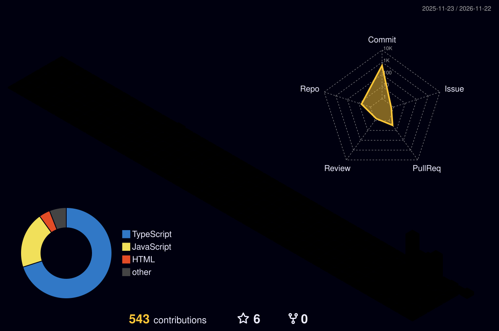

###  Hola, soy Sergio

Estudio Tecnología en Desarrollo de Software en la Uniagustiniana (jornada nocturna) y busco un **contrato de aprendizaje** de tiempo completo. Me muevo entre dos cosas: **automatizar procesos con n8n** y **construir aplicaciones web** con React, TypeScript y Firebase.

Trabajo cada proyecto por fases, con versiones, CHANGELOG, pruebas y una fase legal antes de darlo por terminado. Si algo no lo he probado, lo digo.

---

###  Proyectos

<table>
  <tr>
    <td width="50%" valign="top">
      
      <b>🔗 Moss Nexus</b> · <code>v1.2.0</code> 
      Flujos de n8n listos para copiar. Cada uno probado en una instancia real, con sus limitaciones escritas.
      <a href="https://sergio-velandia.dev/Moss-Nexus/">Ver →</a>
    </td>
    <td width="50%" valign="top">
      
      <b>🌿 Moss</b> · <code>v1.20.0</code> 
      Mi jardín digital: guías, componentes en vivo, rutas de aprendizaje y una bitácora de lo que sale mal.
      <a href="https://sergio-velandia.dev/Moss/">Ver →</a>
    </td>
  </tr>
  <tr>
    <td width="50%" valign="top">
      
      <b>🍲 Moss Taste</b> · <code>v1.1.1</code> 
      Recetario familiar con cuentas y Firestore. Te dice cuánto comprar y cuánto cuesta en COP.
      <a href="https://sergio-velandia.dev/Moss-Taste/">Ver →</a>
    </td>
    <td width="50%" valign="top">
      
      <b>🌐 Portafolio</b> · <code>v1.2.3</code> 
      Quién soy y cómo contactarme, en español e inglés.
      <a href="https://sergio-velandia.dev/mi-portafolio/">Ver →</a>
    </td>
  </tr>
</table>

---

###  Con qué trabajo

---

###  Experiencia

**Desarrollador de videojuegos** · Empresa privada · `Contrato de aprendizaje · mar – ago 2026`
Mecánicas de física, rigging y animaciones con **Lua** en **Roblox Studio** para un juego multijugador de terror de **12 niveles**, con entregas por nivel según lo que pedían mis líderes.

---

###  Ahora mismo

- Probando una por una las plantillas de **Moss Nexus** en n8n real.
- Diseñando **Vitae Tech**: la hoja de vida digital de cada equipo de cómputo, para técnicos y empresas pequeñas.
- Curso de bases de datos en **Google Cloud**.

---

###  Certificaciones

---

###  Actividad

<!-- Se regenera cada día con la Action profile-3d.yml -->

<picture>
  <source media="(prefers-color-scheme: dark)" srcset="https://raw.githubusercontent.com/Sergio-Velandia/Sergio-Velandia/output/github-contribution-grid-snake-dark.svg" />
  <source media="(prefers-color-scheme: light)" srcset="https://raw.githubusercontent.com/Sergio-Velandia/Sergio-Velandia/output/github-contribution-grid-snake.svg" />
  
</picture>

Desde Bogotá 🇨🇴

